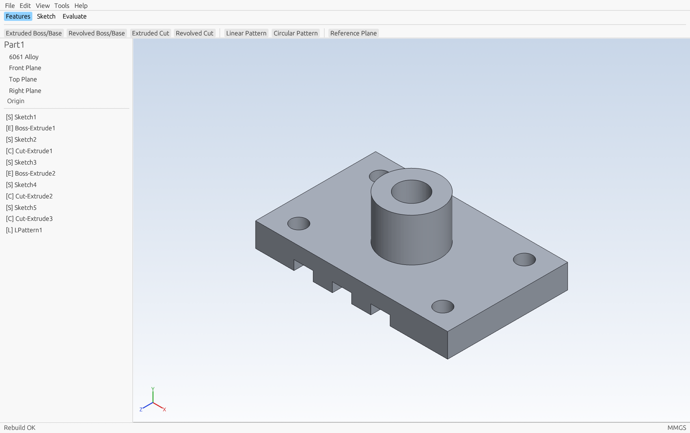

# AnvilCAD

Free and open source parametric 3D CAD, written in Rust, with its own geometry kernels.
If you know SOLIDWORKS, the workflow will feel familiar: a feature tree, sketches on planes
or faces, fully defined sketches, extrudes and revolves, equations, custom properties and
templates. AnvilCAD is an independent project, not affiliated with Dassault Systèmes, and
it works without SOLIDWORKS installed (see [INTEROPERABILITY.md](INTEROPERABILITY.md)).

The goal is a complete, free engineering stack: CAD now, then CAM, PDM and PLM (see
[ROADMAP.md](ROADMAP.md)).



Status: early (0.1). The core modelling loop works end to end. Large parts of a full CAD
system are still ahead; see the roadmap.

## What works today

**Sketching**
- Line (chained), centerline, rectangle, circle, centerpoint arc
- Snapping to existing points and the origin, automatic horizontal/vertical relations
- Relations: coincident, horizontal, vertical, parallel, perpendicular, equal, tangent,
  concentric, midpoint, point on line/circle, fix
- Dimension tool that infers the dimension from the picks and where its value is placed:
  length, horizontal/vertical/aligned distance, point-to-line and parallel-line distance,
  diameter, radius, arc length, angle in the chosen sector, and diameter about a
  centerline; values take arithmetic and units; over-defining dimensions can become
  reference dimensions ([spec](docs/re/sketch-dimension.md))
- Constraint solver with degree-of-freedom reporting (under / fully / over defined, with
  conflicting relations highlighted)
- Drag points and circles while relations stay satisfied
- Construction geometry
- Convert Entities: a face's edges copied into a sketch as fixed curves

**Features**
- Extruded Boss/Base and Extruded Cut: Blind, Mid Plane, Through All, Through All - Both,
  Up To Next, Up To Vertex, Up To Surface and Offset From Surface (leaning planes too),
  reverse, a second direction, draft inward or outward (exact cones and leaning planes),
  a start offset, flip side to cut, and thin walls on open or closed sketches
  (one-direction, mid-plane, two-direction, rounded corners, capped ends)
  ([spec](docs/re/extrude-revolve.md))
- Revolved Boss and Revolved Cut about any sketch line: one direction, mid plane or two
  directions, reverse, thin walls
- Swept Boss/Base and Swept Cut along smooth paths of lines and arcs, with a sketch or
  round profile, one way, the other or both ([spec](docs/re/sweep-and-loft.md))
- Linear Pattern (two directions, seed only, skipped instances), Circular Pattern
  (instance or equal spacing, both ways, skipped instances, about any axis or reference
  axis), sketch-driven patterns, and Mirror of features or the whole body in one or two
  planes, all exact ([spec](docs/re/mirror-and-patterns.md))
- Draft (neutral plane, with outer, inner or all-loop propagation), Dome (spherical or
  elliptical) and Rib (parallel or normal to the sketch, open or closed contours)
  ([spec](docs/re/rib-draft-dome.md))
- Lofts between two profiles (exact ruled faces) or through three or more
- Multibody parts: Combine (add, subtract, common), Move/Copy, Delete/Keep, Split and Scale,
  and extrusions that leave a separate body ([spec](docs/re/multibody.md))
- Fillet (constant radius, with a circular, conic rho, conic radius or
  curvature-continuous profile, and tangent propagation to the edges that run smoothly on
  from those selected) and Chamfer (equal distance, angle and distance, or offset
  face) on any edge between two faces, built exactly: straight and round edges in closed
  form, any other edge with a rolling-ball round or a swept bevel; edges that run smoothly
  into each other are blended as one; convex edges are rounded off, concave edges are
  filled in
- Shell to a uniform wall thickness, with any faces opened
- Holes at sketch points: drilled, counterbored, countersunk and tapped, blind (with a
  drill point) or through, with an optional near-side countersink, sized from ISO metric
  and ANSI inch fastener tables
- Reference planes (offset, parallel through a point, three points, line and point, at an
  angle, mid plane, normal to a curve), reference axes, reference points and coordinate
  systems ([spec](docs/re/reference-geometry.md))
- Sketch on Front/Top/Right planes, reference planes, or any planar model face
- Edit, suppress, rename, delete (with dependents), roll back

**Assemblies**
- Assemblies (`.anvasm`) of part files placed as components, each instance named
  `part<n>`; the first component is fixed, later ones float; fix, float, hide and show
- Mates: coincident, concentric, parallel, perpendicular, tangent, distance, angle and
  lock, between faces, straight and circular edges, and the standard planes and origins of
  components and of the assembly, with aligned, anti-aligned or closest alignment; a new
  distance or angle starts at what the components measure now
- A solver that places components from their mates (damped least squares over rigid
  placements) and reports each component as fixed `(f)`, under defined `(-)` with the
  motions left, fully defined, or over defined `(+)`; mates that conflict, or a distance or
  angle another mate already fixes, are flagged ([spec](docs/re/assemblies-and-mates.md))
- Bill of materials: one row per part and configuration, with part number, description
  and quantity

**Evaluate**
- Measure: lengths, radii, arc and chord lengths, areas and perimeters of edges and faces,
  and distances (minimum, centre or maximum for round entities), normal distances and
  angles between two picks, exact on exact parts; Section View with one to three planes,
  which shows the part cut open without changing it ([spec](docs/re/measure-and-section.md))

**Parameters and properties**
- Global variables with equations (`width = 80`, `depth = width / 2`, functions like
  `sqrt`, `sin` in degrees, `min`, `max`); type `=width` into any dimension to link it
- Configurations: variants of a part in one file, with feature suppression, feature
  dimensions, global variables and material set per configuration; derived configurations
  that inherit from a parent; configuration-specific properties; a configuration manager
  tab and a configuration table that edits every configuration and rebuilds them all
  ([spec](docs/re/configurations.md))
- Material library (26 metals and plastics: carbon and alloy steels such as A36, 1018 and
  4140; 304, 316 and 17-4 stainless; 5052, 6061 and 7075 aluminum; brass, copper,
  titanium; Delrin, UHMW, HDPE, PTFE, nylon, PEEK, polycarbonate, acrylic, ABS, PLA, PVC)
  with density, strength, stiffness, thermal conductivity and manufacturing limits
- Mass properties: mass (g, kg, lb), volume, surface area, center of mass, inertia
  tensor and principal moments, bounding box

**Design for manufacturing**
- Check Design (Evaluate tab or Tools menu) for CNC machining or sheet metal, using the
  part's material. Click a finding to highlight its faces.
- CNC machining: thin walls (thinner limits for metals than plastics), small and deep
  holes, tight or deep inside radii, and sharp inside corners no tool end can reach
- Sheet metal: one thickness throughout, bend radius against the material's smallest
  (A36 1x thickness, 6061-T6 2.5x, Ti-6Al-4V 4.5x...), flange length, hole size, and
  hole distance from edges, other holes and bends
- Limits are common shop rules of thumb; the report says which ones a part breaks
- Custom properties (text, number, date, yes/no)
- Part templates (`.anvprtdot`)

**Files**
- Native part format `.anvprt` and assembly format `.anvasm` (versioned JSON, written
  atomically; assemblies keep part paths relative to themselves)
- STEP import (AP203, AP214, AP242 parts): planes, cylinders, cones, spheres, tori and
  B-spline surfaces, in millimetre, inch or metre units. Bodies made of planes,
  cylinders, cones, tori, spheres and B-spline surfaces import as exact solids, so features added to them build exactly
  (files written to a looser tolerance are healed: each vertex moves to where its edges
  meet, within ten times the accuracy the file declares); everything
  else imports as a watertight mesh body. AP242 tessellated bodies (triangulated faces)
  import as meshes too. Open a `.step` or `.stp` file to start a part.
- Export to STEP AP214 (exact geometry whenever the whole part was built exactly, facets
  otherwise), STL (binary) and OBJ
- SOLIDWORKS files are identified and explained, and their custom properties shown
  without SOLIDWORKS (see below)

**CAM (library and tests only; no user interface yet)**
- `crates/anvil-cam`: 2.5D milling from the top of the part (see `docs/cam/`)
- Feature recognition from the part: through and blind holes from cylindrical faces,
  closed pockets with islands from planar floors and vertical walls
- Adaptive clearing with a hard cap on radial engagement, checked by an independent
  verifier that replays the tool path into its own material model; helical or side entry,
  links through cleared space, optional feed raised for chip thinning
- Facing, contour finishing with cutter compensation done in CAM (exact arcs, lead-in and
  lead-out arcs), drilling cycles (drill, chip-break peck, full peck)
- Tool library (flat, ball, bull nose, drill) with holders, and starting cutting data for
  each material in the library; setups with work offsets and stock; an automatic
  operation plan from the recognised features
- Stock simulation on height fields with gouge, rapid-through-material, shank and holder
  collision checks
- Post processors as declarative TOML (examples for a generic Fanuc-style mill, LinuxCNC
  and GRBL), a G-code verifier that rejects undeclared dangerous constructs (G10 writes,
  macro variables, subprogram calls, file output, override locks and others), and
  certification that requires both the verifier and the simulator to pass
- Optional, off by default: AI-proposed post edits and AI review of edits through the
  Claude API, advisory only (they can add warnings or block, never approve)

**Application**
- Undo/redo for every change, unsaved-changes prompts
- Shaded view with edges, standard views, zoom to fit, face highlighting and picking

## Migrating from SOLIDWORKS

`anvil-migrate` converts SOLIDWORKS parts to AnvilCAD parts with their feature tree:
sketches with relations and dimensions, extrudes, cuts, revolves, patterns, reference
planes, global variables and equations, material and custom properties.

It runs on a Windows machine with SOLIDWORKS installed. SOLIDWORKS reads each file through
its public API, which is the same approach commercial history-based translators use, so
every release SOLIDWORKS can open is supported. Files are opened read-only and never saved.
If SOLIDWORKS is already running, the tool attaches to it and leaves any documents you have
open untouched.

```bash
anvil-migrate -o D:\migrated D:\vault\projects
```

How a part is translated:

1. Features are read in tree order. Sketches keep their geometry, relations and driving
   dimensions; sketches on faces stay attached to the AnvilCAD face where possible.
2. After each solid feature, SOLIDWORKS is rolled back to that point and its exact volume is
   compared with AnvilCAD's rebuild. When a translation does not match, plausible variants
   are tried (for example the opposite direction).
3. Features AnvilCAD cannot rebuild yet (sweeps, lofts, variable-radius fillets and so on), or whose
   translation does not match, become an **imported body**: SOLIDWORKS' own geometry at that
   point in the tree. Translation then continues parametrically on top of it, so later
   sketches, cuts and patterns stay editable.
4. Global variables become AnvilCAD variables, and equations driving dimensions are linked
   when they can be expressed (otherwise the value is kept and the report says so).

Every file gets a status in `migration-report.csv` / `.json`:

| Status | Meaning |
|---|---|
| Parametric | Every geometric feature was rebuilt as an editable AnvilCAD feature |
| Hybrid | Some features came across as imported geometry; the report lists which and why |
| Failed | The file could not be read |
| Skipped | Assemblies and drawings (not migrated yet) |

`verified` means the migrated part's volume matches SOLIDWORKS within 1%. Imported
geometry is a fine triangle mesh, so curved imported faces carry a small faceting error;
`--precise-geometry` tightens it at the cost of speed.

Limitations today: parts only (assemblies and drawings are next), the active configuration
only, and edits to features above an imported body do not flow through that body.

Native files (`.sldprt` etc.) are also recognised directly by the AnvilCAD app, which
shows their custom properties (next section) and explains how to migrate them.

## Migrating a whole organisation: anvil-bulk

`anvil-bulk` moves an organisation's archive of SOLIDWORKS files, years of it across many
shares, to AnvilCAD without SOLIDWORKS. The original files are only read. Every step takes
time proportional to the number of files (and their size, for hashing), and the
conversion runs on as many machines as you give it.

```bash
anvil-bulk scan   --project \\server\migration --step-root \\server\step-exports \\server\eng \\server\archive
anvil-bulk run    --project \\server\migration        # on each worker machine
anvil-bulk status --project \\server\migration --workers 20
anvil-bulk export --project \\server\migration --out \\server\anvilcad
```

1. **scan** finds every SOLIDWORKS file in the given folders, network shares or synced
   cloud folders, hashes its contents, and pairs each part with a STEP export of it:
   `<name>.step` or `.stp` beside it, or at the same relative path under `--step-root`.
   Copies of the same file (common in a 20-year archive) become one job. Re-running a scan
   re-reads only files that changed.
2. **run** converts jobs. Point any number of machines at the same project folder: each job
   is claimed with an atomic file creation, so it is done exactly once. A run can be
   stopped at any time and started again; finished jobs are never redone, and jobs held by
   a worker that died are taken over after `--claim-timeout`. A damaged file fails alone.
3. **export** writes the migrated tree: one `.anvprt` per original part at the same relative
   path, carrying the file's custom properties and any AnvilCAD properties added with
   `anvil-props`. Parts already in the output are kept, so edits are never overwritten.
4. **report** (also run by `run` and `export`) writes `files.csv` (every file: status,
   duplicate of, bodies, volume, properties, migrated part), `properties.csv` (every
   property of every file), and `summary.csv` / `summary.json` (counts by status, by year
   last modified and by top-level folder).

| Status | Meaning |
|---|---|
| exact | Geometry from the STEP export, every body exact |
| faceted | Geometry from the STEP export, some bodies as meshes |
| parametric / hybrid | Feature tree recovered by the optional anvil-migrate plug-in |
| properties only | Assemblies and drawings: properties recorded, contents not migrated yet |
| no geometry source | A part with no STEP export: export one and run again |
| failed | The reason is in `files.csv` |

Geometry comes from STEP, so the organisation exports STEP from its own SOLIDWORKS
before its licences end (SOLIDWORKS can batch-export a folder). Two optional plug-ins
recover more while licences last: `--with-anvil-migrate` converts parts with
`anvil-migrate`, keeping feature trees, on a machine with SOLIDWORKS; a Document Manager
key (`ANVIL_SWDM_KEY`) reads properties of files saved by SOLIDWORKS 2015 or later.
Neither is needed for anything else.

## SOLIDWORKS custom properties, without SOLIDWORKS

Open `wheel.sldprt` in AnvilCAD and its File Properties window shows the properties your
engineers already set (`Description: large wheel`, `Process: Lathe`, `Finish: galvanized`),
with SOLIDWORKS neither running nor installed. The file is only ever read. The file's own
properties are shown read-only and stay the file's. AnvilCAD's own properties for the file
are kept beside it in `wheel.sldprt.anvilprops.json`, never inside the SOLIDWORKS file. If
both use the same name, both are shown and the file's own value is kept.

AnvilCAD reads them through public interfaces only (see
[INTEROPERABILITY.md](INTEROPERABILITY.md)):

| Files saved by | Read through | Where |
|---|---|---|
| SOLIDWORKS 2014 or earlier | the standard OLE property sets Microsoft documents ([MS-OLEPS]), the same ones Windows Explorer shows | any OS |
| SOLIDWORKS 2015 or later | the SOLIDWORKS Document Manager API Dassault publishes, with your Document Manager licence key in `ANVIL_SWDM_KEY` | Windows |
| either, once converted | the `.anvilprops.json` snapshot written by `anvil-props convert` | any OS, no licence |

### Converting a whole company's files

`anvil-props convert` walks folders, network shares (`\\server\eng`, `/mnt/eng`) and folders
synced by cloud storage clients (OneDrive, SharePoint, Google Drive, Dropbox). For every
SOLIDWORKS file it records the file-level and configuration properties, with link
expressions, in a property file beside it. AnvilCAD properties already there are kept.
Run it once, on Windows with a Document Manager key, while your SOLIDWORKS subscription is
active. Afterwards every AnvilCAD user sees the properties on any computer with no
SOLIDWORKS licence. Re-running only re-reads files that changed.

```bash
set ANVIL_SWDM_KEY=<your Document Manager key>
anvil-props convert -o D:\props-report \\server\eng\projects
```

- `properties.csv`: every property of every file, a company-wide index you can load into a
  spreadsheet or PDM.
- `conversion-report.csv` / `.json`: one row per file (converted, up to date, failed),
  with the reason for each failure.
- `--store <DIR>` keeps property files in a separate folder, mirroring each file's full
  path, when the share is read-only (AnvilCAD finds them through `ANVIL_PROPS_STORE`).
  `--dry-run` reads and reports without writing; `--force` re-reads everything.
- `anvil-props show [--json] wheel.sldprt` prints one file's properties.

The Document Manager key comes from Dassault Systèmes under your SOLIDWORKS subscription.
Check its terms for your use. AnvilCAD never stores the key. To try the feature without
SOLIDWORKS, `cargo run -p anvil-props --example sample_part -- wheel.sldprt` writes a
stand-in part with custom properties.

## Architecture

```
crates/
  anvil-brep     exact kernel: curves (line, circle, ellipse, B-spline) and surfaces
                 (plane, cylinder, cone, torus, sphere, B-spline), exact booleans, traced intersection curves,
                 extrude, fillets and chamfers, topology checks, watertight tessellation
  anvil-kernel   faceted kernel: math, profiles, triangulation, polygon B-rep solids,
                 booleans (BSP), extrude/revolve, shell, mass properties, picking
  anvil-sketch   2D sketcher: entities, constraints, solver, profile extraction
  anvil-model    parametric part document: feature tree, rebuild, equations,
                 materials, mass properties, design-for-manufacturing checks,
                 custom properties, file format
  anvil-step     STEP reader (ISO 10303-21, never panics on malformed files), B-rep
                 import as exact solids or meshes, exact AP214 export
  anvil-io       faceted STEP / STL / OBJ export, SOLIDWORKS file identification,
                 file properties (compound files, OLE property sets, Document Manager,
                 .anvilprops.json sidecars), late-bound COM automation
  anvil-app      desktop application (egui + wgpu: Metal, Vulkan, DX12)
  anvil-migrate  anvil-migrate: SOLIDWORKS to AnvilCAD converter (Windows; talks to
                 SOLIDWORKS through late-bound COM automation)
  anvil-props    anvil-props: shows and bulk-converts custom properties of SOLIDWORKS
                 files without SOLIDWORKS
  anvil-bulk     anvil-bulk: organisation-wide migration (inventory, deduplication,
                 resumable multi-machine conversion from STEP, migrated tree, reports)
```

Kernel design notes:
- Two kernels work together. `anvil-brep` builds parts exactly: its surfaces are
  analytic, and its booleans intersect them exactly. Where the answer is a line, circle
  or ellipse it is computed in closed form; anything else between cylinders, cones and
  planes (a hole drilled across a shaft, say) is traced; a torus meets planes and surfaces
  on its own axis in exact circles, and so does a sphere (any axis through its centre).
  Off its axis a torus becomes its exact rational B-spline patch and is traced like any
  freeform face.
  Sphere faces are laid out by stereographic projection from the point opposite the
  face, and cone faces that reach their apex (drill points) by projection along the
  axis, so neither has poles or seams to handle. Freeform (B-spline) faces lie in their
  patch's own parameters scaled to millimetres, with seams added where a patch wraps.
  Traced curves between analytic surfaces are found this way: each straight line of one
  surface meets the other at the roots of a quadratic, so every traced point is exact,
  and the points are joined into a cubic B-spline refined until it stays within 1e-7 mm
  of both surfaces. A cone's quadric has two nappes; only the face's own is kept, and a
  curve that reaches the apex (where it has a corner, and may pass to the other nappe)
  is split there into pieces that end exactly at the apex. Where two analytic faces only
  touch (a boss flush against a side, a pin against a bore), the contact divides
  neither face: bodies that just touch stay separate, and a result that would touch
  itself along the contact, leaving no thickness there, is refused as
  zero-thickness geometry. A freeform face meets any surface (another freeform face included)
  by marching: start points where the other surface crosses the patch's sample grid,
  then steps along the curve with Newton corrections back onto both surfaces, ending
  exactly on a patch edge; the points are fitted the same way, to 1e-7 mm. Surfaces that
  only touch (a fillet meeting the face it blends into) are refused rather than traced.
  Imported faces whose edges stray from their freeform surface (by up to the healing
  reach) are cut tolerantly: a traced cut is bent onto the point where it crosses such
  an edge. `anvil-kernel` is a faceted kernel that covers everything else.
- The rebuild runs on the exact kernel while every feature so far is one it supports
  (extrudes, revolves, cuts, patterns, shells, and fillets and chamfers on straight
  edges between flat faces and on circular edges or arcs between faces round about the
  same axis; selected edges that run smoothly one into the next, such as a slot's
  outline, are blended together so their rounds join; any other edge between two faces
  gets a rolling-ball round, a B-spline surface fitted to exact ball sections, one round
  along a whole smooth run of such edges; chamfers there are swept the same way, set out
  by equal distance, angle and distance, or offset faces; conic and curvature-continuous
  fillets are swept the same way on any edge, the latter meeting each face with its own
  curvature). A revolved profile of lines and arcs sweeps planes, cylinders, cones, spheres
  and tori exactly, with pointed cones and sphere poles where it meets the axis. A round
  edge is filleted with a torus (chamfered with a cone) by a boolean with the corner's
  cross-section revolved about the axis. A shell is the part less its cavity: every
  face offset inwards onto its exact offset surface (removed faces outwards), each edge
  and corner solved where the offset faces meet, keeping the part's shape; a wall too
  thick for that, a sealed hollow or a freeform face goes to the faceted kernel. The
  behaviour is specified in [docs/re/shell-and-fillet.md](docs/re/shell-and-fillet.md)
  and [docs/re/fillet-curved-edges.md](docs/re/fillet-curved-edges.md), the latter
  studied with REA from Dassault's published help pages only.
  After each exact feature the faceted body is regenerated from the exact result, so
  display, picking, mass properties, export and later features work unchanged. The first
  feature the exact kernel cannot build, or declines, hands the part over to the faceted
  kernel for the rest of the tree. A feature is never built worse than the faceted kernel
  alone would build it. The bundled sample part builds exactly from start to finish, its
  boss's rim and root filleted with tori, and matches the faceted-only volume to 0.013%.
- Face names are shared by both kernels: the feature id plus a stable index derived from
  the sketch entity (0 start cap, 1 end cap, 2 + entity for side faces), so sketches on
  faces and edge selections survive whichever kernel built the face.
- Every exact solid passes a topology check (closed, consistently oriented, valid Euler
  characteristic) before it is used. Exact booleans are tested with randomized boxes on an
  integer grid, which makes faces, edges and corners coincide constantly, against exact
  volumes. Operations the exact kernel cannot do yet (open intersection curves such as a
  plane parallel to a cone's axis, bodies touching along an edge, internal voids) are
  reported, never guessed.
- Faceted solids are planar convex polygons, each tagged with its face name and exact
  surface. Their booleans use BSP trees (iterative, no recursion limits), then T-junctions
  are repaired so results are watertight. Curved faces are faceted at 0.01 mm chord
  tolerance.
- The sketch solver minimises constraint residuals with a damped minimum-norm Gauss-Newton
  method, so under-defined sketches move as little as possible when edited.

## Building

Linux and macOS: `cargo run --release -p anvil-app`

Windows with MSVC (Visual Studio Build Tools installed): `cargo run --release -p anvil-app`

Windows without Visual Studio (GNU toolchain):

```bash
rustup toolchain install stable-x86_64-pc-windows-gnu
winget install BrechtSanders.WinLibs.POSIX.UCRT   # GNU binutils
bash scripts/setup-windows-gnu.sh                 # one time
bash scripts/build.sh run --release -p anvil-app
```

Run the tests with `cargo test --workspace` (or `bash scripts/build.sh test --workspace`).
The app crate's tests drive the real UI with simulated mouse input, so sketching,
dimensioning, dragging, face picking, extruding and undo are covered without a window.

STEP import is checked against the NIST MBE PMI CAD test models (33 files from several
CAD systems, AP203 and AP242). Every file imports, every solid is watertight, and the
volumes of the same part exported by different systems agree to within 0.15%. 32 of the
33 import as exact solids (the last stores only triangles). Five of the
files are kept in `crates/anvil-step/tests/data` as regression tests (see the NOTICE
there). To check a folder of your own STEP files:
`cargo run --release -p anvil-step --example report -- <folder>`.

Command line: `anvilcad [FILE.anvprt | --sample] [--screenshot OUT.png] [--edit-sketch ID]`

To drive the app from a script or a coding agent without opening a window (it never takes
focus or touches your mouse and keyboard), use `anvilcad-agent`; see
[docs/AGENT_HARNESS.md](docs/AGENT_HARNESS.md).

## Using it

| Action | Input |
|---|---|
| Rotate | Middle mouse drag, or arrow keys |
| Pan | Ctrl + middle drag, or right drag |
| Zoom | Mouse wheel (about the cursor), Shift + middle drag |
| Standard views | Ctrl+1 Front, 2 Back, 3 Left, 4 Right, 5 Top, 6 Bottom, 7 Isometric, 8 Normal To |
| Zoom to fit | F |
| Undo / Redo | Ctrl+Z / Ctrl+Y |
| Save / Open / New | Ctrl+S / Ctrl+O / Ctrl+N |
| Rebuild | Ctrl+B |
| Cancel tool / clear selection | Esc |
| Delete selection | Delete |

Typical flow: select a plane in the tree (or click a planar face), Sketch tab > Sketch,
draw and dimension, Exit Sketch, then Features > Extruded Boss/Base. Help > Open Sample
Part loads a model that uses most features.

## Roadmap

The full roadmap is in [ROADMAP.md](ROADMAP.md). In short:

1. CAD: surfaces of revolution and curved-edge fillets in the exact kernel, a hole
   feature with standard sizes, mirror, sweep, loft, multi-body parts, sheet metal,
   assemblies with mates, drawings, AP242 assemblies and PMI, a scripting and plugin API
2. CAM: 2.5D adaptive clearing and finishing, feature recognition, a tool and
   feeds-and-speeds library, simulation with gouge and collision checks, and community post
   processors with a verifier; then 3-axis surfacing, 4- and 5-axis, and turning
3. PDM: a versioned vault with check-in and check-out, metadata, life-cycle states and an
   open API
4. PLM: bills of materials, change management, requirements and quality records

Interoperability with SOLIDWORKS and other commercial systems is built natively, from open
standards (STEP) and from documented reverse-engineering work, so no feature needs
commercial software installed.

## History

The exact kernel (`anvil-brep`) and the wgpu renderer began as a separate project,
ferrocad, and were merged into AnvilCAD in October 2026.

## Contributing

Contributions are welcome. Please read [CONTRIBUTING.md](CONTRIBUTING.md) (commits carry a
Developer Certificate of Origin sign-off) and the interoperability rules in
[INTEROPERABILITY.md](INTEROPERABILITY.md).

## License

Licensed under either of [MIT](LICENSE-MIT) or [Apache-2.0](LICENSE-APACHE), at your
option. Unless you state otherwise, any contribution intentionally submitted for inclusion
in AnvilCAD shall be dual licensed as above, without any additional terms or conditions.

## Trademarks

SOLIDWORKS, CATIA, 3DEXPERIENCE and Dassault Systèmes are trademarks or registered
trademarks of Dassault Systèmes or its subsidiaries. CAMWorks, SolidCAM and other product
names are trademarks of their owners. They are used here only to describe compatibility;
AnvilCAD is not affiliated with or endorsed by any of these companies.
