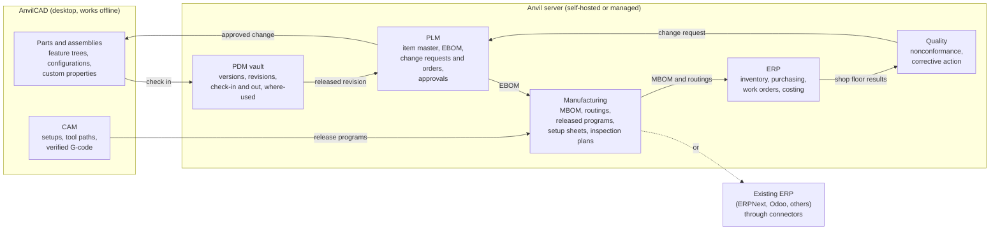

# One platform: CAD, CAM, PDM, PLM and ERP that flow together

AnvilCAD's long-term aim is an open engineering stack in which a part goes from sketch to
shipped product without being re-keyed: the model, its revisions, its bill of materials, its
change history, its machining programs and the orders that build it are one connected
record. This document says how the pieces fit, what runs where, whether the business
systems should live inside AnvilCAD, and in what order to build them. The item-level plans
for each area stay in [ROADMAP.md](../ROADMAP.md).

Status: a direction, not a commitment. Nothing here beyond "Today" exists yet.

## The flow



The thread through all of it is one identifier per item and one revision history. A
drawing, a CAM program and a purchase order all point at "bracket 10-0042 rev C", so
where-used, impact analysis and traceability fall out of the data instead of being
reconciled by hand.

## Where it runs

Three deployments, one code base, all open source:

| | Who it is for | What it is |
|---|---|---|
| **Local** | One engineer, or anyone offline | AnvilCAD alone. A vault in a folder on your disk: history, revisions and where-used, with no server and no account. This is what works today, extended. |
| **Self-hosted** | Teams and firms that keep data on their own machines | The Anvil server on their own hardware or cloud: one container or binary, SQLite for a small team, PostgreSQL for a large one, sign-in through their own identity provider (OIDC or SAML). |
| **Managed** | Teams that would rather not run a server | The same server, run for them. Their data stays exportable in open formats, and they can move to self-hosting at any time with one export and import. |

Rules that hold in every deployment:

- **AnvilCAD never requires the server.** Every modelling, CAM and file workflow works on a
  laptop with no network, as every feature must work without SOLIDWORKS today. The server
  adds sharing, control and the business processes; it never gates opening your own files.
- **No lock-in.** Every record can be exported as plain files (the `.anvprt` JSON, CSV,
  STEP AP242 with metadata) and re-imported elsewhere. A managed customer and a
  self-hosted one run the same code.
- **An open API first.** Everything the user interfaces do goes through a documented REST
  API (OpenAPI), so scripts, the `anvil` Lua API and other systems can do the same.

## Should PDM, PLM and ERP live inside AnvilCAD?

**Recommendation: one experience, not one binary.** The business systems should be a
separate server and web application that AnvilCAD connects to, with the parts an engineer
needs built into AnvilCAD as panels, so that day to day it feels like one app.

Why not build them into the AnvilCAD binary:

- **Different shapes of software.** A CAD client is a single-user, GPU-heavy desktop app
  that must work offline. PDM, PLM and ERP are multi-user, database-backed services with
  permissions, audit logs, background jobs and integrations. Putting a database server and
  a workflow engine inside a CAD binary makes both worse.
- **Different users.** Buyers, planners, quality staff and managers need the item master,
  orders and approvals, not a B-rep kernel. They should get a browser, not a CAD install.
- **Different release and security rhythms.** A server faces the network and needs prompt
  security releases and migrations; the CAD client should be able to stay on a version a
  customer has validated.
- **The "never require" principle.** If the vault lived in the app, it would be tempting to
  make features depend on it. Keeping it separate keeps AnvilCAD whole on its own.

Why it still feels like one app:

- **Panels in AnvilCAD.** A Workspace panel beside the feature tree: browse the vault,
  check in and out, see revisions and where-used, read and write the item's properties,
  see open change orders against the part, and release. It talks to the server's API and
  falls back to the local vault offline.
- **The same identity everywhere.** One sign-in, the same item numbers, and links that open
  the same record in either place (`anvil://item/10-0042?rev=C` opens AnvilCAD; the web app
  has the same path).
- **Shared code.** The vault, the data model and the properties logic are Rust crates used
  by both the desktop app and the server (see below), so the two can never disagree about
  what a revision is.
- **A web viewer.** The server shows parts and assemblies in the browser by compiling
  AnvilCAD's own tessellation to WebAssembly, so people without AnvilCAD can still look,
  measure and comment.

Revisit this if the panels end up needing most of the server inside the client. That would
be the sign that a combined app is simpler after all.

## Architecture

```text
crates/
  anvil-vault        content-addressed storage, versions, revisions, references,
                     where-used, local and remote back ends (used by app and server)
  anvil-records      the shared data model: items, BOM lines, changes, routings,
                     lifecycle states; serialisation and migrations
  anvil-props        custom properties and the company-wide index (exists today)
  anvil-server       the HTTP API, auth, permissions, audit log, jobs, connectors
  anvil-web          the browser app: viewer (WebAssembly), item, BOM, change and
                     order screens, administration
  anvil-app          AnvilCAD, with a Workspace panel that is a client of the API
```

The server crates would adopt the same lints as the kernel (no `unsafe`, no `unwrap`) and
the same rule that bad input returns an error instead of panicking.

## Build order

Each phase ends with something a real team can use. Later phases depend on earlier ones;
nothing in a later phase is needed to use an earlier one.

| Phase | Delivers | Done when |
|---|---|---|
| **0. Today** | Versioned JSON part files, `anvil-props` (properties without SOLIDWORKS, a company-wide `properties.csv`), `anvil-bulk` (migrating whole archives) | Exists |
| **1. Local vault** | History, revisions, where-used and check-in inside AnvilCAD, stored in a folder; no server | One engineer can revise a part and an assembly, see where a part is used, and roll back, offline |
| **2. Team server** | The self-hosted Anvil server: shared vault, check-out locks, sync with the local vault, OIDC sign-in, audit log, OpenAPI, the web viewer | A team of five shares a project across three operating systems, with no lost edits and a full history |
| **3. PLM** | Item master and part numbering schemes, engineering BOM from assemblies, lifecycle states, change requests and change orders with approvals, release | A change goes from request to approved, released revision, with the affected items and documents found automatically |
| **4. Manufacturing hand-off** | Manufacturing BOM and routings, CAM programs released with their part revision, setup sheets and inspection plans; connectors to ERPNext and Odoo, and generic CSV and REST | A released revision creates or updates the item, BOM and routing in an existing ERP without retyping |
| **5. ERP for shops that have none** | Inventory, purchasing, work orders, costing and quoting, and a shop-floor view (tablet-friendly work instructions, G-code download, results back) | A small machine shop runs quote to shipment on the platform |
| **6. Quality and beyond** | Nonconformance and corrective action tied to items and revisions, supplier records, requirements and verification links; OSLC, ISO 10303-239 (PLCS) and AP242 exchange | A nonconformance on the shop floor becomes a change request against the right revision |

Managed hosting can start once phase 2 is solid; it is the same server.

**Build or integrate?** Build the engineering side (PDM, PLM, the manufacturing hand-off),
because that is where AnvilCAD's data lives and where no open tool does it well. For ERP,
integrate first (phase 4) with the open-source ERPs many shops already run, and build the
native modules (phase 5) only for the smallest shops, who have no ERP at all. Accounting,
payroll and tax stay out of scope; connect to the systems that do them.

## Decisions for the maintainer

These are open and change the plan:

1. **A name** for the server and web app (this document says "Anvil server").
2. **Licence for the server.** MIT OR Apache-2.0 like the rest of the project is simplest
   and friendliest to firms. AGPL-3.0 would stop a third party from offering a closed
   hosted fork. Either way the desktop app and the kernels stay permissive.
3. **Whether to offer managed hosting**, and if so who runs it. It is the natural way to
   fund the project, as with other open-source infrastructure, but it is a business, with
   support, uptime and data-protection obligations.
4. **Which ERP connector comes first.** ERPNext and Odoo are the obvious open ones; a
   commercial one may matter more to early adopters.
5. **SOLIDWORKS PDM import.** ROADMAP.md's PDM item 5 (moving a SOLIDWORKS PDM vault through
   its published API with the customer's own client) is the PDM counterpart of
   `anvil-migrate` and could be the strongest reason for a firm to adopt phase 2. Like
   every SOLIDWORKS-facing feature, it starts with an REA study written up in `docs/re/`
   (see [CLAUDE.md](../CLAUDE.md)).
